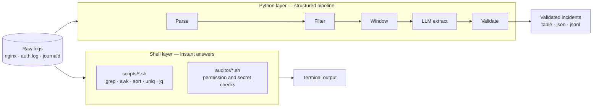
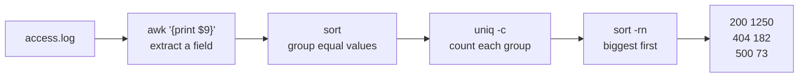
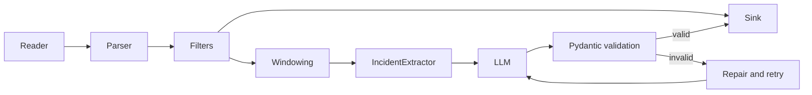
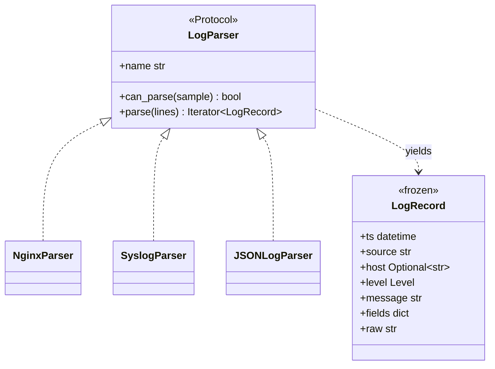
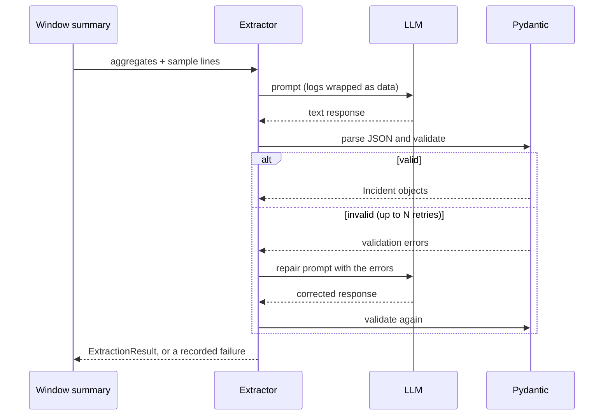
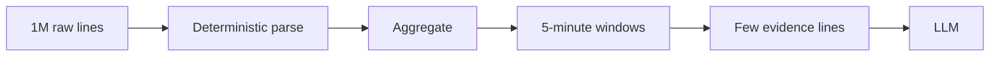
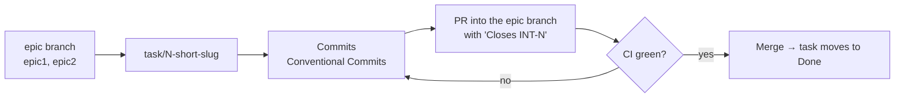
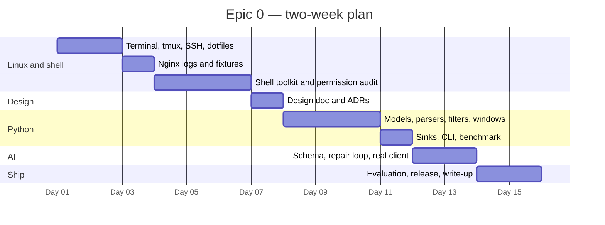

# LogLens

> **Terminal-first log intelligence for engineers.**
> Fast Unix pipelines → a typed Python CLI → validated, structured incident reports from an LLM.

LogLens answers the questions you ask when you SSH into a broken server and have nothing but a terminal:

- Which IPs are hammering the server?
- When did the 5xx errors start?
- Which endpoints are failing or slow?
- Is someone brute-forcing SSH?
- Did a service restart right before things broke?
- Can this evidence become a structured incident report?

**The one idea behind the project:**

> Do the deterministic log processing with plain code first. The LLM is an *optional last step*, never the parser.

---

## Contents

1. [How it works](#how-it-works)
2. [Project status](#project-status)
3. [Quick start](#quick-start)
4. [What's in the repo](#whats-in-the-repo)
5. [The shell toolkit](#the-shell-toolkit)
6. [The Python CLI (planned)](#the-python-cli-planned)
7. [LLM incident extraction](#llm-incident-extraction)
8. [Testing and evaluation](#testing-and-evaluation)
9. [Contributing](#contributing)
10. [Roadmap and Definition of Done](#roadmap-and-definition-of-done)
11. [Out of scope](#out-of-scope)
12. [Troubleshooting](#troubleshooting)

---

## How it works

LogLens has two layers that read the same raw logs. Use whichever fits the moment.



| Layer | Best for | Needs an API key? |
|---|---|---|
| **Shell** | "What is happening *right now*?" Quick triage on any Linux box. | No |
| **Python** | Repeatable, typed analysis across several log formats. | Only for the final `extract` step |

### Why build it this way?

| Habit | What it means here |
|---|---|
| Terminal first | Everything works over plain SSH, with no GUI. |
| Clarify before coding | Requirements, estimates, and an SLO are written down before the Python. |
| Composition over inheritance | Parser, filter, and sink are small pieces plugged together. |
| One internal format | Every parser outputs the same `LogRecord`. |
| Stream, don't load | Iterators and generators, so a huge log never becomes one giant list. |
| LLM output is untrusted | Validate against a schema and repair bad output. |
| Measure everything | Benchmark speed and memory, compare estimated and actual cost. |
| Ship it | CI, a tagged release, docs, and a short demo are part of "done". |

---

## Project status

This is **Epic 0 — Terminal-First Foundations** of a larger learning roadmap: about two weeks, targeting a `v1.0.0` release.

| Area | State |
|---|---|
| Repo skeleton, CI, pre-commit hooks, contribution rules | ✅ Done |
| `scripts/nginx_status_count.sh` — status code counts (INT-1) | ✅ Done |
| `scripts/ip_rate_analyzer.sh` — IPs over a request threshold (INT-3) | ✅ Done |
| `auditor/check_file_modes.sh` — unsafe file modes | ✅ Done |
| `auditor/check_ssh_permissions.sh` — `~/.ssh` permissions | ✅ Done |
| `auditor/check_env_leaks.sh` — secrets in files and env (masked output) | ✅ Done |
| JSON error extractor with `jq` (INT-2) | ⏳ Merged, then reverted — to be redone |
| Full shell toolkit (`shell/loglens.sh`) | ⏳ Planned |
| Design doc (`docs/design.md`) | ⏳ Planned |
| Python CLI (`parse`, `stats`, `windows`) | ⏳ Planned |
| LLM incident extractor + evaluation | ⏳ Planned |
| `v1.0.0` release | ⏳ Planned |

> The Python package under `src/loglens/` currently exports only its version. The module layout is documented in each folder's own `README.md`.

---

## Quick start

### Prerequisites

- Linux (Ubuntu 24.04 LTS or similar) and Bash
- Python 3.12+ and [`uv`](https://docs.astral.sh/uv/)
- `jq`, `shellcheck`, `shfmt`

### Set up

```bash
git clone https://github.com/Ayoush/LogLens.git
cd LogLens

uv sync --all-groups        # install the dev tools (mypy, pytest, ruff)
uv tool install pre-commit  # then register the git hooks (details in RULES.md)
pre-commit install
cp .env.example .env        # only needed for the LLM step; never commit it
```

### Try the shell tools

Create a tiny sample in standard Nginx format (field 1 is the IP, field 9 is the status code):

```bash
mkdir -p data/raw_logs
cat > data/raw_logs/access.log <<'EOF'
10.0.0.1 - - [29/Sep/2026:10:00:01 +0530] "GET / HTTP/1.1" 200 123 "-" "curl"
10.0.0.2 - - [29/Sep/2026:10:00:02 +0530] "GET /login HTTP/1.1" 200 421 "-" "Mozilla/5.0"
10.0.0.3 - - [29/Sep/2026:10:00:03 +0530] "GET /api HTTP/1.1" 500 912 "-" "curl"
10.0.0.3 - - [29/Sep/2026:10:00:04 +0530] "GET /api HTTP/1.1" 500 901 "-" "curl"
EOF

scripts/nginx_status_count.sh data/raw_logs/access.log
# 500 2
# 200 2

scripts/ip_rate_analyzer.sh data/raw_logs/access.log 1
# 2 10.0.0.3
```

Files in `data/raw_logs/` are gitignored. To share a fixture, sanitize it and put it in `tests/fixtures/`.

### Run the auditors

```bash
auditor/check_file_modes.sh /some/directory    # SUID, SGID, world-writable files and dirs
auditor/check_ssh_permissions.sh               # ~/.ssh, authorized_keys, private keys
auditor/check_env_leaks.sh /some/path          # API keys and passwords (values are masked)
```

Exit codes are meaningful: `0` means clean, `1` means findings, `2` means a usage error.

---

## What's in the repo

```text
LogLens/
├── scripts/       Small single-purpose log analyzers (INT-1, INT-3)
├── auditor/       Permission and secret auditors
├── shell/         Planned: loglens.sh toolkit and shared lib/
├── src/loglens/   Planned: Python package (parsers/, extract/, CLI)
├── tests/         pytest tests; fixtures/ holds sanitized sample logs
├── eval/          Planned: evaluation scripts and windows
├── docs/          Planned: design.md, ADRs, lab notes
├── data/          Local, gitignored raw logs
├── tools/hooks/   check.sh — branch, commit, and PR rule checks
├── .github/       CI workflows and the PR template
├── RULES.md       Contribution rules (read this first)
└── pyproject.toml uv project, ruff, mypy --strict, pytest config
```

Every folder has its own `README.md` explaining what belongs there.

---

## The shell toolkit

The shell layer is deliberately simple. The goal is to get fast at `awk | sort | uniq -c | sort -rn`.

Each tool is one pipeline:



| Script | What it does | Task |
|---|---|---|
| `scripts/nginx_status_count.sh FILE` | Counts HTTP status codes, most frequent first | INT-1 |
| `scripts/ip_rate_analyzer.sh FILE N` | Lists IPs with more than `N` requests | INT-3 |
| `auditor/check_file_modes.sh DIR` | Flags SUID/SGID files and world-writable files/dirs | — |
| `auditor/check_ssh_permissions.sh` | Checks `~/.ssh` is `700` and keys are `600` | — |
| `auditor/check_env_leaks.sh PATH` | Finds secrets in files and env vars, masks the values | — |

All scripts use `set -euo pipefail`, write errors to stderr, and return a non-zero exit code on bad input. They must pass ShellCheck.

**Planned commands** for `shell/loglens.sh`: `top-ips`, `status`, `5xx-per-min`, `top-paths`, `slowest`, `user-agents`, `ssh-fails`, `ssh-users`, `journal-errors`, `restarts`, `big-files`, `window`. Rotated and gzipped logs will be read with `zcat -f access.log*`.

---

## The Python CLI (planned)

### Pipeline

Each stage has a single job and the stages are plugged together (composition, not inheritance):



Everything up to the `Sink` runs **without an API key**.

### Core types



- `LogParser` is a **`Protocol`**, so a new parser can plug in without inheriting from anything.
- The extensibility test: *can a fourth parser be added without editing the existing parsers or the pipeline?*

### Commands

```text
loglens parse   FILE... [--format auto|nginx|syslog|journal]
                        [--since] [--until] [--level] [--grep]
                        [--out table|json|jsonl]

loglens stats   FILE... [--by status|ip|path|level|unit] [--top 10]

loglens windows FILE... [--minutes 5]

loglens extract FILE... [--minutes 5] [--concurrency 4]
                        [--model ...] [--dry-run]
```

`--dry-run` estimates tokens and cost **without** making a paid call.

### Windowing

Records are grouped into fixed time windows (for example five minutes). Each window carries a compact summary: counts by severity, status, and source; top IPs and paths; and a few representative lines. The model receives that summary, **not** the full raw log.

---

## LLM incident extraction

### The flow



### The output schema

```python
class Incident(BaseModel):
    title: str = Field(max_length=120)
    severity: Literal["low", "medium", "high", "critical"]
    category: Literal["availability", "performance", "security", "config", "resource", "other"]
    start: datetime
    end: datetime
    affected: list[str]
    probable_cause: str = Field(max_length=400)
    evidence: list[Evidence] = Field(min_length=1, max_length=5)
    confidence: float = Field(ge=0, le=1)
```

### Three rules for using an LLM safely

1. **Validate everything.** Models return prose around JSON, fenced JSON, bad enum values, and truncated output. Parse, validate, repair, and give up after a bounded number of retries.
2. **Logs are attacker-controlled.** A user-agent or SSH username can contain text that looks like instructions. Wrap logs in `<logs>…</logs>`, tell the model it is *data*, and test with a malicious fixture.
3. **Control cost.** Parse and aggregate first, send small windows, use `--dry-run` before spending money, and compare the estimate against actual usage.



Secrets go in `.env` (see `.env.example`: `LOGLENS_LLM_API_KEY`, `LOGLENS_LLM_MODEL`, `LOGLENS_LLM_BASE_URL`). It is gitignored. Set a hard spend limit with your provider before any paid run.

---

## Testing and evaluation

**Tests never touch the network.** The LLM is replaced by a fake client.

| Area | What is tested |
|---|---|
| Parsers | A golden test per parser, plus malformed lines |
| Filters | Each filter independently |
| Windowing | Boundaries, especially records exactly on a window edge |
| CLI | Smoke tests with Typer's runner |
| LLM | Fake client returning: valid JSON, fenced JSON, prose + JSON, invalid enum then repaired, permanently invalid |

**Quality gates in CI:** Ruff, shfmt, ShellCheck, secret scanning, `mypy --strict`, and pytest.

**Evaluation (planned, in `eval/report.md`):**

| Measure | Target |
|---|---|
| Schema validity after repair, over 200 windows | ≥ 95% |
| Precision / recall / category agreement, on 30 hand-labelled windows | Reported |
| Estimated vs actual daily LLM cost | Gap explained |
| Prompt-injection fixture | Behavior documented |
| Benchmark on ~1M generated Nginx lines | Constant memory, within a 1 CPU / 1 GB limit |

---

## Contributing

Read **[RULES.md](RULES.md)** before your first commit. The short version:



1. **Branch name:** `task/<number>-short-slug`, for example `task/3-ip-rate-analyzer`.
2. **PR description** contains exactly one `Closes INT-<number>` matching the branch number.
3. **One PR per task**, opened against the epic branch.
4. **Conventional Commits:** `feat: add nginx status analyzer`, `fix: handle missing log file`, `chore: update CI`.
5. Hooks run on `git commit`. Install them once per clone with `uv tool install pre-commit && pre-commit install`.

A wrong branch name or task link fails silently in the tracker, so CI rejects it to make the mistake visible.

---

## Roadmap and Definition of Done



Do 30 minutes of [OverTheWire Bandit](https://overthewire.org/wargames/bandit/) every night alongside.

### Definition of Done

**Linux and shell**
- [ ] `bootstrap.sh` reproduces the environment on a clean user
- [ ] Bandit level 20+ completed, with notes
- [ ] `loglens.sh` works on fixtures and compressed logs
- [ ] Ten random log questions answerable in under two minutes each
- [ ] Permission auditor catches the planted lab problems

**Engineering practice**
- [ ] Trunk-based workflow enforced, Conventional Commits enforced, CI green
- [ ] Release automation produces `v1.0.0`
- [ ] DORA numbers recorded (tag frequency, lead time from first commit to merge)

**Design**
- [ ] `docs/design.md` has clarifying questions, FR/NFR, estimates with formulas, an SLO, trade-offs, and non-goals

**Python**
- [ ] `mypy --strict` passes and core coverage is at least 85%
- [ ] Three parsers share one `Protocol`; a fourth can be added with minimal changes
- [ ] 1M lines parse in constant memory

**AI**
- [ ] Schema validity measured on 200 windows; precision/recall on 30 labelled windows
- [ ] `--dry-run` works; no test calls the network; no secrets committed
- [ ] Prompt-injection behavior documented

**Presentation**
- [ ] README has architecture and metrics; a short terminal demo exists
- [ ] The whole system can be demoed in about five minutes

---

## Out of scope

Epic 0 deliberately does **not** build:

- real-time tailing daemons
- a web UI
- database-backed log storage
- multi-machine log shipping
- container deployment
- a multi-provider LLM gateway

Possible stretch work *after* the Definition of Done: `loglens tail -f`, a second LLM provider behind the same interface, a local Ollama model, a Dockerfile, signed incident webhooks, and Postgres-backed storage.

---

## Troubleshooting

| Problem | Likely cause | Fix |
|---|---|---|
| `Permission denied (publickey)` | Wrong SSH key or file permissions | Run `auditor/check_ssh_permissions.sh` |
| `/var/log/auth.log` is missing | `rsyslog` not installed | Install it, or use `journalctl -u ssh` |
| `uniq -c` counts look wrong | Input was not sorted | `sort` before `uniq` |
| Pipeline exits early under `pipefail` | Upstream got SIGPIPE from `head` | Handle it deliberately |
| Nginx timestamp won't parse | Format or timezone mismatch | Use `%d/%b/%Y:%H:%M:%S %z` |
| Syslog year is wrong | Classic syslog has no year | Inject the year and handle the Dec → Jan rollover |
| Many LLM results fail validation | Malformed output or an over-strict schema | Tighten the prompt, strip code fences, review constraints |
| HTTP 429 during extraction | Concurrency too high | Lower `--concurrency`, add backoff with jitter |
| Disk is full but `du` looks small | A deleted file is still held open | Find it with `lsof +L1` |

---

## Learning resources

- **Linux:** Linux Journey · *The Linux Command Line* (Shotts) · OverTheWire Bandit · Julia Evans' zines · `jq` manual
- **Git / DevOps:** Pro Git · Conventional Commits · Trunk Based Development · DORA · pre-commit
- **Design:** Refactoring.Guru · *A Philosophy of Software Design* (Ousterhout) · PEP 544 (`typing.Protocol`) · Google SRE book on SLOs
- **Python / AI:** `uv` · Pydantic v2 · Typer · `asyncio` · Anthropic and OpenAI API docs

---

## License

No license has been chosen yet. Pick one before making the repository public.
